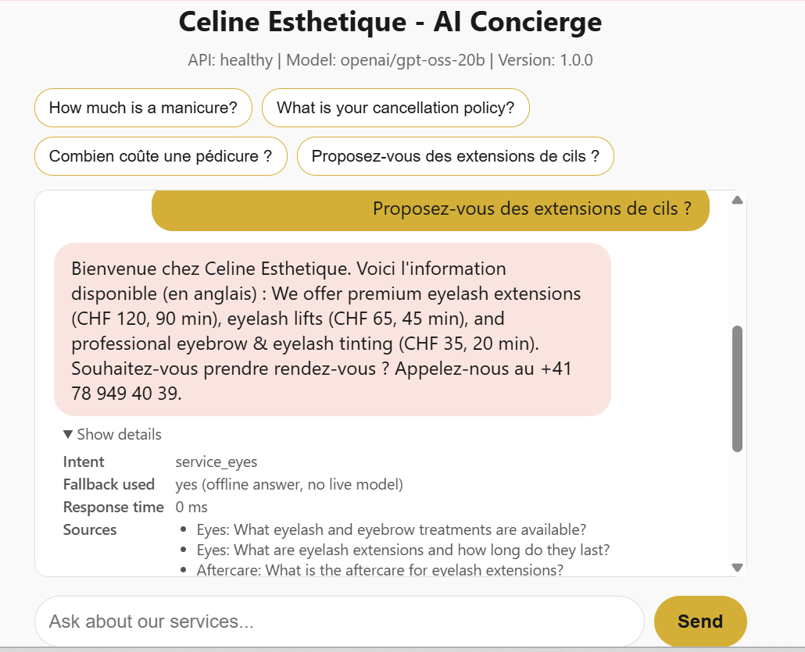
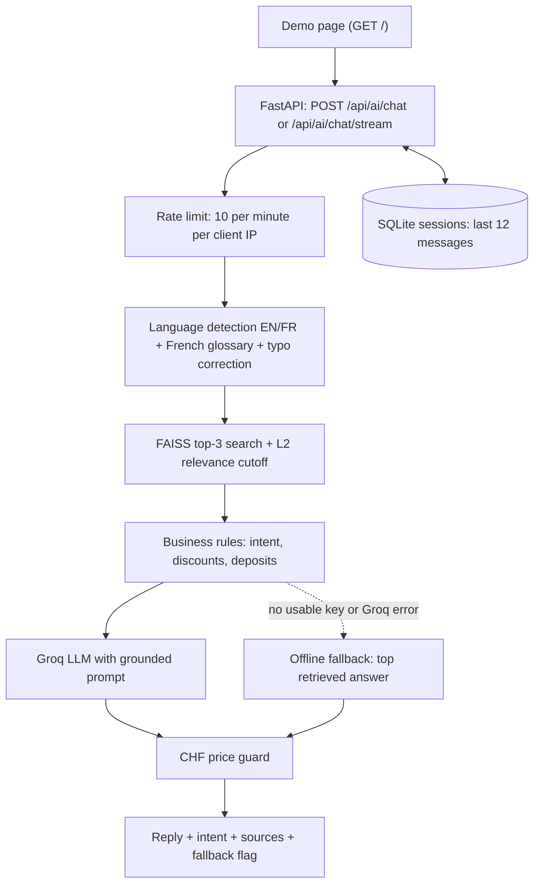

# Celine Esthetique AI Concierge

FastAPI RAG concierge for a Lausanne beauty salon: it answers English and French questions from a curated price list, and replaces any reply that quotes a CHF price not in the salon data.

Built during my TechNexus internship for a real client (Celine Esthetique, Lausanne); published with permission.


## Live demo

Live demo: deploying this week (link coming soon).

The first request after a quiet period may be slow while the service starts.



## What it does

A visitor asks about services, prices, opening hours or the booking policy of Celine Esthetique, in English or French. The backend finds the most relevant entries among 50 curated salon Q&As (sentence embeddings and a FAISS index), computes the salon's discount and deposit figures in code, and asks a Groq-hosted LLM to answer in the visitor's language using only that context. A price guard then checks every CHF amount in the reply against the salon data and the computed figures; an unknown price makes the reply be replaced by a safe message with the salon's phone number. Without a usable Groq key, or if Groq fails, the API falls back to the best retrieved answer.

## Key features

- **Retrieval-augmented answers:** 50 salon Q&A entries embedded with `all-MiniLM-L6-v2`, exact L2 search in FAISS (top 3), and a relevance cutoff (`RAG_MAX_L2_DISTANCE`, default 1.20) so off-topic questions get no context and a phone-number fallback.
- **English and French:** language detection, a "reply in the customer's language" rule in the prompt, and a French glossary (services, prices, booking, opening hours and weekdays) that adds English search terms for retrieval. The knowledge base itself is English.
- **Typos and follow-ups (retrieval only):** misspelled service words close to a known service name are corrected with the standard-library `difflib` ("peducure" → "pedicure"); numbers and prices are never changed. A message with no match of its own that looks like a follow-up ("and for the feet?") is searched together with the previous user message. The prompt always shows the real message.
- **Pricing rules in code:** VIP 10% and first-time 15% discounts (VIP wins, they never stack), 20% deposit on luxury services and the cancellation policy. Computed figures are put into the prompt as exact numbers.
- **CHF price guard:** a reply that quotes a CHF amount that is not in the salon data or the computed figures is replaced, on both the JSON and the streaming endpoint. Amounts typed by the user are not accepted as proof.
- **Streaming:** `POST /api/ai/chat/stream` (Server-Sent Events) uses the same retrieval, prompt, key check and fallback as the JSON endpoint.
- **Session memory:** the last 12 messages per session in SQLite. The in-memory fallback copy drops sessions idle for `SESSION_TTL_MINUTES` and keeps at most `SESSION_MEMORY_MAX_SESSIONS`.
- **Operational safeguards:** 10 requests per minute per client IP, optional trusted-proxy handling that uses the right-most `X-Forwarded-For` hop (spoofed left entries are ignored), an environment-driven CORS allowlist, security headers on the demo page (a Content-Security-Policy with hashes of its inline script and style, `nosniff`, no framing), and logs that never contain any part of the API key or the message text.
- **Demo page** served by the API at `/`: example questions in English and French, a typing indicator, a mobile layout, and a "Show details" toggle per reply (intent, retrieved sources, response time, fallback flag).
- **Docker image** with CPU-only PyTorch, a non-root user and the embedding model baked in, plus GitHub Actions CI (blocking ruff, tests with a 94% coverage gate, no API key).

## Architecture



## Engineering decisions

- **One retrieval path.** `/chat` and `/chat/stream` build their turn in one function, so retrieval, prompt, fallback and guard cannot drift apart (covered by parity tests).
- **Strict price guard.** Prices are the part of a salon answer that must not be invented, so every CHF figure is checked against the data and the computed rules; a failed check replaces the whole reply.
- **Rules in code, not in the prompt.** Discounts and deposits are computed in Python and tested; the LLM is told to quote the computed figures and not to calculate others.
- **No LLM in tests or CI.** Groq is replaced by a fake client and constructing a real one raises, so the suite runs without a key and without cost.
- **Trusted-proxy handling.** The client IP comes from the right-most `X-Forwarded-For` entry (the one the proxy appends); entries a client adds on the left are ignored.
- **Container built to start offline.** CPU-only PyTorch, a non-root user (uid 1000), code read-only for that user, and the embedding model baked in, so the app starts with no network.
- **SQLite for sessions.** Plain standard-library `sqlite3` with a small in-memory fallback copy: no extra service to run, at the cost of sessions being local to one instance.

## Results

Tests, coverage and the retrieval evaluation were measured on 2026-11-08 (Windows, Python 3.11.9). Docker figures were measured on 2026-11-07 from a local build and run, not from the hosted demo.

| Area | Result |
|---|---|
| Tests | 141 pytest tests, all passing, no API key needed (LLM mocked) |
| Coverage | 96.05% line coverage (CI fails below 94%) |
| Retrieval evaluation | hit@1 0.85, hit@3 0.91, MRR@3 0.88 on 47 questions (see below) |
| Off-topic rejection | 8 of 8 off-topic questions got no context at the 1.20 cutoff |
| Docker image | 2.32 GB (539 MB compressed content); PyTorch `2.3.1+cpu`, no CUDA |
| Docker runtime | runs as uid 1000; starts with networking disabled; 10.9 s from `docker run` to the first `/health` 200; 400.7 MiB RAM after one chat |
| Live latency (p50 / p95) | to be measured after deployment |

**Retrieval evaluation.** `scripts/eval_retrieval.py` runs each question through the app's own retrieval path (language detection, French glossary, FAISS, cutoff, top 3) with no LLM. The set (`data/eval/retrieval_eval.jsonl`) is **written by the project author, not real user traffic**: 47 on-topic questions (31 English, 16 French, 9 of them deliberately hard: typos, indirect wording, short follow-ups) and 8 off-topic questions. The scores describe this set only. Each question is asked on its own, without conversation history.

| Group | Questions | hit@1 | hit@3 | MRR@3 |
|---|---|---|---|---|
| All | 47 | 0.85 | 0.91 | 0.88 |
| English | 31 | 0.77 | 0.87 | 0.82 |
| French | 16 | 1.00 | 1.00 | 1.00 |
| Hard | 9 | 0.67 | 0.78 | 0.72 |

The first run (2026-11-07) gave 0.83 / 0.89 / 0.86 overall. The question set was not changed between runs; the one new hit is "c'est ouvert le dimanche ?" (new glossary words). Four questions still get none of their expected entries in the top 3: "How many years has the salon been in business?", "Do you do Brazilian waxing?", "is the gel thing one where I pay something upfront?", and "and for the feet?" (the set has no history, so the follow-up handling cannot apply; it is covered by unit tests instead). A regression test fails if any of these scores drops.

## Run locally

Requires Python 3.11 (the version CI uses).

```bash
git clone https://github.com/ameema28/celine-chatbot-rag-backend.git
cd celine-chatbot-rag-backend
python -m venv venv
source venv/bin/activate          # Windows: venv\Scripts\activate
pip install -r requirements.txt
# optional: set GROQ_API_KEY in .env for live answers
cp .env.example .env              # Windows: copy .env.example .env
uvicorn app.main:app --reload
```

On Linux, to avoid the large default PyTorch download, install the CPU build first: `pip install torch==2.3.1 --index-url https://download.pytorch.org/whl/cpu`.

Open http://127.0.0.1:8000/ for the demo page or http://127.0.0.1:8000/docs for Swagger UI. Without a Groq key the API runs in offline fallback mode (the best retrieved answer, with a greeting on the first reply of a session). The demo page shows "n/a (offline fallback)" as the response time for these replies, because they are not timed.

**With Docker Compose:**

```bash
docker compose up -d      # http://localhost:8000 ; .env is optional
docker compose down
```

Sessions are kept in a named volume.

| Method | Path | Description |
|---|---|---|
| `GET` | `/` | Demo chat page |
| `GET` | `/health` | Status, model name, whether a usable key is set (`llm_ready`) |
| `POST` | `/api/ai/chat` | JSON reply: `reply`, `intent`, `session_id`, `fallback_used`, `response_time_ms`, `retrieved_context` |
| `POST` | `/api/ai/chat/stream` | Same pipeline as Server-Sent Events, ends with `[DONE]` |

Request body for both POST routes: `message` (1-500 characters) and an optional `session_id` (letters, digits, `-` and `_`, at most 64 characters; anything else gets a 422).

### Environment variables

| Variable | Default | Meaning |
|---|---|---|
| `GROQ_API_KEY` | none | Groq API key. Missing, a `your_...` placeholder or under 20 characters means offline fallback |
| `GROQ_MODEL_NAME` | `openai/gpt-oss-20b` | Groq model ID |
| `EMBEDDING_MODEL_NAME` | `all-MiniLM-L6-v2` | Sentence-transformers model (baked into the Docker image) |
| `RAG_MAX_L2_DISTANCE` | `1.20` | Relevance cutoff on squared L2 distance; lower is stricter |
| `CORS_ALLOW_ORIGINS` | localhost ports 3000, 5173, 5500 | Comma-separated browser origins allowed to call the API |
| `TRUST_PROXY` | `false` | Read the client IP for rate limiting from `X-Forwarded-For` (only behind a proxy that appends it) |
| `TRUST_PROXY_HOPS` | `1` | With `TRUST_PROXY`, which entry from the right is the client (1 = right-most) |
| `SESSIONS_DB_PATH` | `./sessions.db` (`/tmp/sessions.db` in Docker) | SQLite session file |
| `SESSION_TTL_MINUTES` | `60` | In-memory session copy: drop sessions unused for this long (SQLite keeps them) |
| `SESSION_MEMORY_MAX_SESSIONS` | `1000` | In-memory session copy: maximum kept (least recently used dropped first) |
| `PORT` | `7860` in the Docker image | Port the container listens on |
| `PROJECT_NAME`, `VERSION` | see `app/config.py` | Display metadata |

## Testing

No API key is needed: Groq is replaced by a fake client in every test.

```bash
pip install -r requirements.txt -r requirements-dev.txt
pytest tests/ -p no:cacheprovider --cov=app --cov-fail-under=94
ruff check app tests scripts
```

Scripts in `scripts/` (standard library only, no key) work against any running URL:

- `eval_retrieval.py` runs the retrieval evaluation above.
- `smoke_check.py --url <URL> --out <file>` checks health, the demo page, an English and a French chat, streaming, the price guard and the rate limit.
- `benchmark.py --url <URL> -n 20 --out <file>` measures sequential `/chat` latency (p50, p95, max).

Output files must be outside the repository.

## Deployment

See [DEPLOYMENT.md](DEPLOYMENT.md) for Docker, hosting settings, environment variables, session behaviour and the post-deploy checks.

## Limitations

- **No authentication.** Anyone with a `session_id` can continue that session, and anyone with the URL can chat.
- **Sessions are temporary on the hosted demo.** The container keeps its SQLite file in `/tmp`, so history is lost when the service restarts or scales to zero.
- **English knowledge base.** French questions are answered by the LLM from English data; French answer quality has not been measured.
- **Answer quality is not evaluated.** Only retrieval is measured, on an author-written set. The price guard checks CHF amounts, not other facts such as opening hours.
- **Simple follow-up and typo handling.** Follow-ups use only the previous user message, and only when the current message finds nothing by itself and is very short, starts with a word such as "and"/"et", or contains "it"/"that"/"ça". Typo correction covers service words of 5+ letters only. Four questions in the evaluation set are still missed (see Results).
- **Single process.** The rate limit (10 requests per minute per IP) and the in-memory session copy live in one process; they are not shared between instances.
- **Depends on Groq.** If the key or the model is unavailable, replies are the best retrieved answer, not generated text.
- **Large image.** The Docker image is 2.32 GB (PyTorch and its dependencies).

## Credits

Built by Ameema Rashid during the TechNexus internship for Celine Esthetique. Published with permission for portfolio purposes. All rights reserved.
